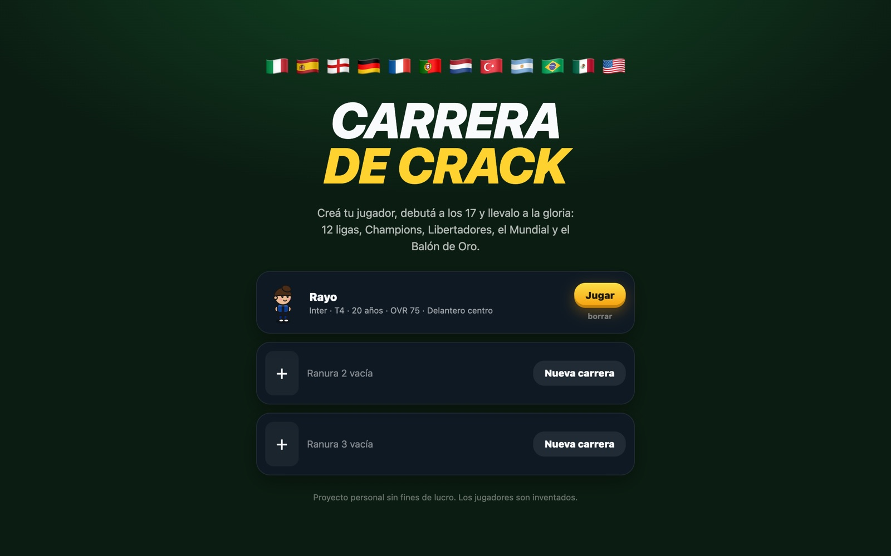
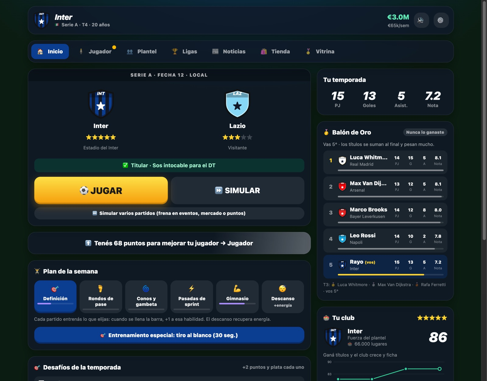
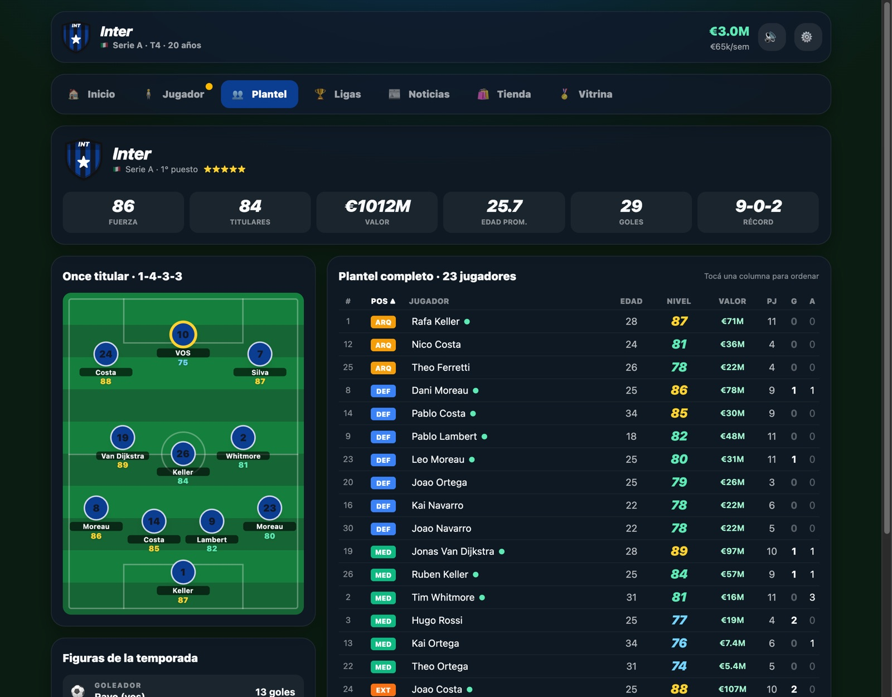
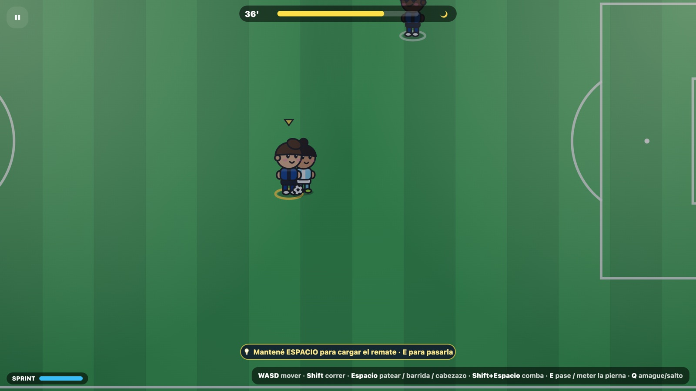
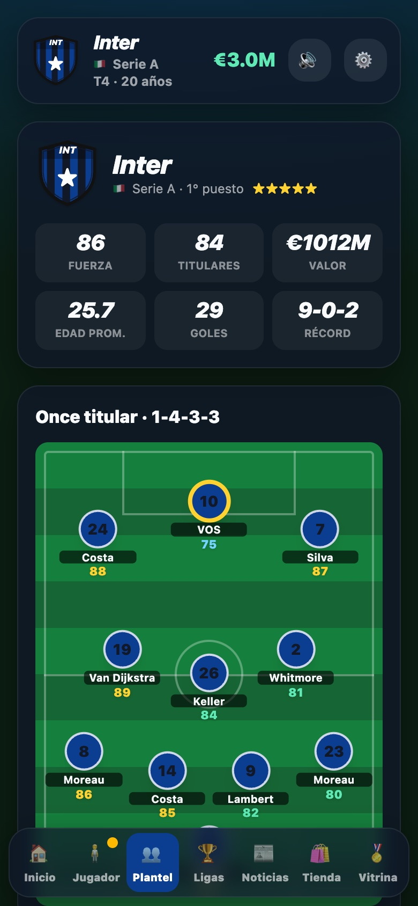

# Carrera de Crack ⚽

**🇬🇧 [English](#english) · 🇦🇷 [Español](#español)**

<p align="center">
  
</p>

---

## English

**Carrera de Crack** is a football career game that runs in the browser. Create your own big‑headed player, debut at 17 and take them all the way to retirement: 12 leagues, domestic cups, Champions League, Libertadores, the World Cup and the Ballon d'Or.

Everything is drawn and played with code (no image or audio files), it works offline and it can be installed on your phone.

### Play

👉 **https://tomasvales.github.io/carrera-crack/**

### Screenshots

| Home | Squad |
|---|---|
|  |  |

| In a match | On mobile |
|---|---|
|  |  |

### Features

- **Play or simulate** every match. When you play, you control your player in the key moments: one‑on‑ones, counter‑attacks, one‑twos, crosses, long shots, **free kicks with a wall**, **penalties**, the last‑minute chance and the **deciding penalty** in knockouts.
- **Clubs that grow.** Every club gets stronger or weaker each season depending on how it did compared to what was expected. Win titles and your club signs reinforcements; fall apart and it sells its stars. Win the league and the **stadium gets bigger**.
- **Your squad, for real.** A full squad with names, positions (GK, DEF, MID, WING, ST), age, rating, **market value**, games, goals and assists. Every league goal is credited to a real player, and the match commentary names who scored, who you passed to and which keeper saved it.
- **Ballon d'Or race.** Four rivals (the stars of the strongest clubs, plus your nemesis) play the season alongside you. Follow their stats week by week and see the final vote.
- **Fight for your spot.** The coach picks the starters. Sometimes the club signs someone for your position and you have to win the place back.
- **Difficulty that depends on the opponent.** Big teams are tougher, especially when you play for a small club.
- **More than 25 events** with story chains (romance, fights with the captain, bets, goal promises), release clauses, career milestones and a nemesis.
- **Transfer market** between leagues with negotiation rounds, agents, loans.
- **Shop** (boots, celebrations, headbands, lifestyle), **training plan**, national team call‑ups.
- **Newspaper** with news about your career and the world, and tables for every league.
- 3 save slots, export/import your save and a **Hall of Fame**.

> The game is in Spanish (Rioplatense). Players are made up; club names are used for fun and no official crests are included (you can upload your own from the game).

### Controls

| Keyboard | Action |
|---|---|
| WASD / arrows | Move |
| Shift | Sprint |
| Space (hold) | Shoot with power |
| E | Pass / ask for the ball back |
| Short tap on Space | Chip |
| Shift + Space | Curled finesse shot |
| Q | Feint / jump over a tackle |

On mobile: joystick on the left, buttons on the right (best in landscape).

### Development

```bash
npm install
npm run dev     # local server
npm run build   # builds dist/
npm run sim     # simulates 30 full careers to check the game balance
```

Built with React, TypeScript, Vite and Tailwind. Pushing to `main` publishes the game to GitHub Pages automatically.

---

## Español

**Carrera de Crack** es un juego de fútbol con modo carrera que se juega en el navegador. Creá tu jugador "cabezón", debutá a los 17 y llevalo a la gloria hasta el retiro: 12 ligas, copas nacionales, Champions, Libertadores, el Mundial y el Balón de Oro.

Todo se dibuja y suena por código (sin imágenes ni audios), funciona sin internet y se instala en el celular.

### Jugar

👉 **https://tomasvales.github.io/carrera-crack/**

### Capturas

| Inicio | Plantel |
|---|---|
|  |  |

| En el partido | En el celular |
|---|---|
|  |  |

### Qué tiene

- **Jugá o simulá** cada partido. Si jugás, controlás a tu jugador en las jugadas clave: mano a mano, contraataque, pared, desborde, remate de afuera, **tiros libres con barrera**, **penales**, el épico minuto 90 y el **penal decisivo** de los mata‑mata.
- **Clubes que crecen.** Cada temporada los clubes suben o bajan según cómo les fue frente a lo esperado. Si ganás títulos, tu club ficha refuerzos; si se cae, vende a sus figuras. Con los títulos, **se amplía el estadio**.
- **Tu plantel, de verdad.** Plantel completo con nombre, posición (ARQ, DEF, MED, EXT, DC), edad, nivel, **valor de mercado**, partidos, goles y asistencias. Cada gol de la liga se le anota a un jugador real, y el relato del partido nombra al goleador, a quién le pasaste la pelota y qué arquero la atajó.
- **Carrera al Balón de Oro.** Cuatro rivales (las figuras de los clubes más fuertes y tu némesis) juegan la temporada en paralelo. Seguís sus números fecha a fecha y al final ves la votación.
- **Peleá el puesto.** El DT decide quién es titular. A veces el club trae a alguien para tu posición y tenés que ganarte el lugar.
- **Dificultad según el rival.** Los grandes cuestan más, sobre todo si jugás en un club chico.
- **Más de 25 eventos** con cadenas (romances, peleas con el capitán, apuestas, promesas de gol), cláusulas de rescisión, hitos de carrera y un némesis.
- **Mercado de pases** entre ligas con negociación por rondas, representantes y préstamos.
- **Tienda** (botines, festejos, vinchas y estilo de vida), **plan de entrenamiento** y convocatoria a la **selección**.
- **Diario** con noticias de tu carrera y del mundo, y tablas de todas las ligas.
- 3 ranuras de guardado, exportar/importar la partida y **Salón de la Fama**.

> Los jugadores son inventados. Los nombres de los clubes se usan por diversión y no se incluyen escudos oficiales (podés cargar los tuyos desde el juego).

### Controles

| Teclado | Acción |
|---|---|
| WASD / flechas | Mover |
| Shift | Correr |
| Espacio (mantener) | Patear con potencia |
| E | Pase / pedirla de vuelta |
| Toque corto de Espacio | Vaselina |
| Shift + Espacio | Tiro colocado con comba |
| Q | Amague / saltar una barrida |

En el celular: joystick a la izquierda y botones a la derecha (mejor en horizontal).

### Desarrollo

```bash
npm install
npm run dev     # servidor local
npm run build   # genera dist/
npm run sim     # simula 30 carreras completas para revisar el balance
```

Hecho con React, TypeScript, Vite y Tailwind. Cada push a `main` publica el juego en GitHub Pages automáticamente.

Para probar una jugada puntual: Opciones → Entrenamiento con `?jugada=libre` (o `penal`, `mano`, `contra`, `pared`, `afuera`, `banda`) en la URL.
